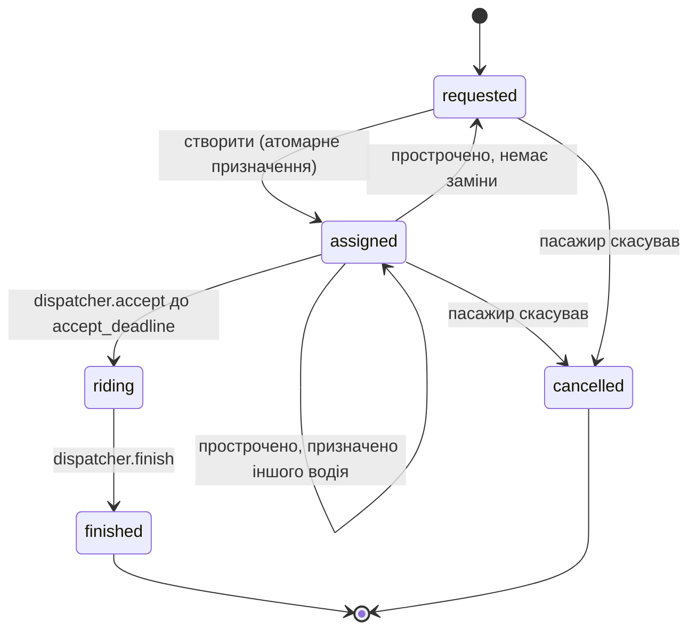
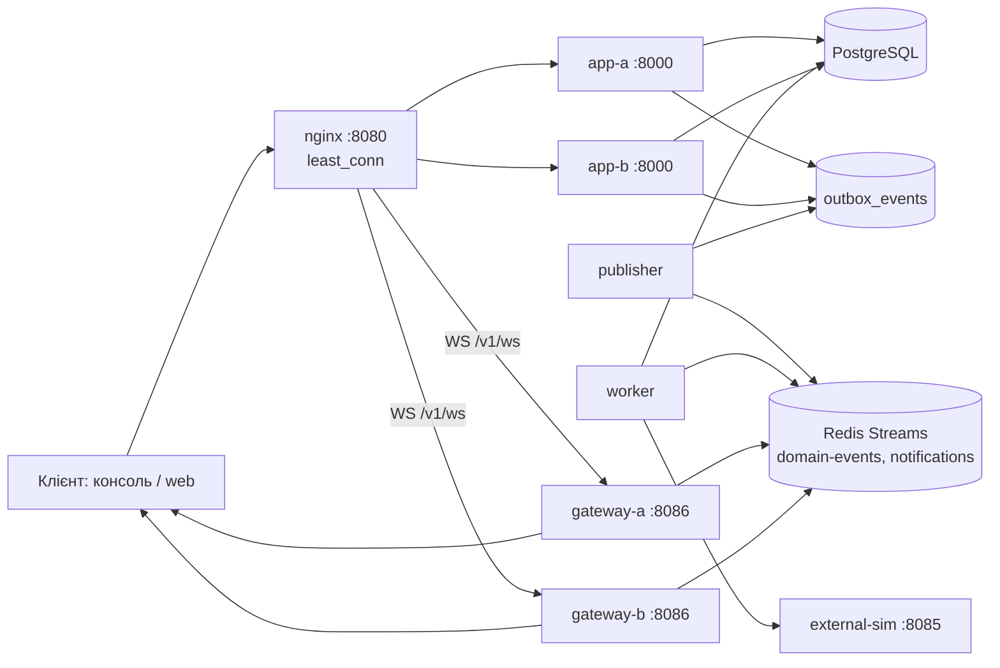

# C14. Таксі — лабораторний проект (Web, 2026)

## 1. Курс і тема

* Курс: «Обмін даними у Web-застосунках», лабораторні ЛР1–ЛР6.
* Тема: **C14. Таксі** (`x-course.topic: C14` у `openapi.yaml`).
* Команда: **Животченко, Стрілець, Лісойван, Кузь**.
* Репозиторій: `https://github.com/kekyoko/taxi-system`.

## 2. Проєкт

### Що робить система

Пасажир замовляє поїздку. Сервер в одній транзакції блокує вільного водія потрібного району
(`SELECT … FOR UPDATE SKIP LOCKED`), створює поїздку зі статусом `assigned`, фіксує події
та сповіщення. Диспетчер приймає поїздку, завершує її й пасажир може оплатити через
асинхронну операцію. Пасажир бачить призначення водія, position авто та завершення
поїздки через WebSocket і через історію сповіщень.

### Ролі

| Роль | Можливості |
| --- | --- |
| `user` (пасажир) | створювати, читати, змінювати адресу, скасовувати свої поїздки, оплачувати, читати свої сповіщення |
| `staff` (диспетчер) | приймати/переназначати/завершувати поїздки, знімати водія з лінії, керувати прапорцями функцій |

### Стани та переходи



Окремий стан оплати: `unpaid → pending → (paid | failed)`.

### Інваріанти й припущення

1. **Один водій — не більше однієї активної поїздки.** Читання вільного водія та його
   перевід у `busy` виконуються в одній транзакції з блокуванням рядка; два екземпляри
   не можуть видати одного водія двом пасажирам.
2. Головна операція ідемпотентна за `Idempotency-Key` (користувач + операція + ключ +
   канонічний відбиток тіла + стан + збережена відповідь в одній транзакції).
3. Зміна адреси — лише з поточним `ETag` (`If-Match`), перевірка й запис однією
   інструкцією `UPDATE … WHERE version = %s`.
4. Повторне скасування не звільняє водія вдруге.
5. Гроші — цілі копійки (`bigint`), валюта `UAH`;округлення `ROUND_HALF_UP` один раз.
6. Нічний тариф 23:00–06:00 у зоні `Europe/Kyiv` застосовується, якщо інтервал
   поїздки `[started, finished)` перетинає ніч, включно з переходом через північ.
7. Час подачі — 2 хвилини (`ACCEPT_DEADLINE_MINUTES`); квиток WebSocket живе 30 секунд.

Тестові дані: `passenger1 / pass123`, `passenger2 / pass123`, `dispatcher / pass123`;
водії `d-1 … d-5` у районі `central`, `d-6 … d-7` у `north`.

## 3. Архітектура



Чому Redis Streams, а не Kafka: методичка допускає інший брокер, що забезпечує ті самі
механізми. Streams дають окремі групи споживачів для `worker`, `gateway-a`, `gateway-b`,
`XAUTOCLAIM` після аварії та стабільні ідентифікатори подій — цього достатньо для
транзакційного outbox і доставки сповіщень без двох реалізацій брокера.

**Шлях головної операції.** `POST /v1/rides` → nginx → один з app → транзакція в
PostgreSQL: ідемпотентний запис → блокування водія → вставка `rides` → події в
`outbox_events` → сповіщення в `notifications` → `COMMIT` → `201 + Location + ETag`.
publisher вичитує outbox через `FOR UPDATE SKIP LOCKED`, публікує в Redis і лише після
цього позначає подію опублікованою.

**Шлях оплати.** `POST /v1/rides/{id}/payments` → `202 + Location: /v1/operations/{op}` →
outbox `payment.requested` → publisher → worker → `POST /sim/charge` з `key = operation_id`
→ одна локальна транзакція (стан операції, історія, сповіщення) → `XACK`.

**Шлях сповіщення.** Подія вихідної черги → `notifications` → кожен шлюз у власній групі
споживачів → тільки власні з'єднання користувача → клієнт. Історія доступна через
`GET /v1/me/notifications?after=` з монотонними позиціями `seq`.

## 4. Структура репозиторію

| Каталог / файл | Призначення |
| --- | --- |
| `app/main.py`, `app/routes/` | FastAPI-сервер, middleware, маршрути ЛР1–ЛР4 |
| `app/domain.py` | чисті правила тарифу, часу, курсору й відбитка тіла |
| `app/db.py`, `app/migrate.py`, `migrations/` | транзакції, outbox, версійні SQL-міграції |
| `app/publisher.py`, `app/worker.py`, `app/broker.py` | outbox publisher і обробник подій |
| `app/faults.py`, `faults/` | керовані точки відмов, спільний том для прапорців |
| `simulator/main.py` | симулятор платіжного шлюзу з `GET /effects` |
| `gateway/main.py` | WebSocket-шлюз (два екземпляри, Origin, квитки, 1008/1012) |
| `client/client.py`, `web/` | консольний і браузерний клієнти |
| `scripts/seed.py`, `scripts/check.py`, `scripts/fault.sh` | демодані, перевірки, керовані відмови |
| `nginx/nginx.conf` | least_conn, проксі WebSocket і симулятора |
| `openapi.yaml` | контракт OpenAPI 3.1 з прикладами та `x-course` |
| `docker-compose.yml`, `Dockerfile`, `.env.example` | запуск усієї системи однією командою |
| `tests/` | юніт-тести чистих правил |

## 5. Збирання й запуск

Вимоги: Docker 24+, Docker Compose v2.24+, ~4 ГБ RAM, вільні порти **8080** (nginx),
**5432** (PostgreSQL), **6379** (Redis).

```bash
cd taxi-system
cp .env.example .env
docker compose build
docker compose up -d
docker compose ps
```

Міграції та демодані застосовуються автоматично сервісами `migrate` і `seed` перед
запуском app. Вручну: `docker compose run --rm migrate`, `docker compose run --rm seed`.

Клієнт і сценарії перевірки запускаються на хості (не в Compose):

```bash
python -m pip install -r requirements.txt
python client/client.py login --login passenger1 --password pass123
python client/client.py ride --pickup "вул. Хрещатик, 1"
python client/client.py list
python scripts/check.py
```

Браузерний клієнт: <http://localhost:8080/web/>. Для перевірки CORS з іншого origin:

```bash
python -m http.server 8081 --directory web
# відкрити http://localhost:8081/cross-origin.html
```

Типові параметри `.env`: `FAULTS=0`, `FEATURE_TARIFFS_V2=0`, `ACCEPT_DEADLINE_MINUTES=2`,
`SIM_MIN_DELAY_MS=200`, `SIM_MAX_DELAY_MS=800`, `SIM_FAIL_RATE=0.10`,
`SIM_DECLINE_RATE=0.10`, `SIM_SEED=taxi-seed`, `CLIENT_ORIGIN=http://localhost:8080`,
`EXTRA_CLIENT_ORIGIN=http://localhost:8081`. Для «виробничої» затримки симулятора
встановіть `SIM_MIN_DELAY_MS=2000`, `SIM_MAX_DELAY_MS=8000`.

## 6. Лабораторні роботи

### ЛР1. Контракт, модель і перша операція

Виконано: **О1.1** (модель, стани, інваріанти вище), **О1.2** (міграції `001…004`,
PK/FK/CHECK/UNIQUE, `timestamptz`, `numeric`, гроші в копійках), **О1.3**
(`openapi.yaml`, приклади, Problem Details; linter — див. команду нижче), **О1.4**
(головна операція в транзакції, 201 + `Location`, 400/404/409/422), **О1.5** (курсор
за парою `created_at, id`, limit 1–50, HMAC-підпис), **О1.6** (`/health`, X-Request-ID,
JSON-журнал), **О1.7** (консольний та веб-клієнти), **Д1.1** (правила часу — чисті
функції), **Д1.5** (нічний тариф, копійки, межі часу).

Перевірка: `python scripts/check.py`, `python -m pytest tests -q`.

### ЛР2. Конкуренція та повторення запитів

Виконано: **О2.1** (`FOR UPDATE SKIP LOCKED` на `drivers`, дослід через обидва
екземпляри), **О2.2** (таблиця `idempotency_records`, канонічний відбиток, 400/409/422),
**О2.3** (`after_commit_before_response`), **О2.4** (клієнт: backoff + jitter,
`Retry-After`, 4 спроби, 30 с, «результат невідомий»), **Д2.4** (`If-Match`/ETag),
**Д2.5** (повторне скасування).

Перевірка: `python client/client.py concurrency --orders 20 --workers 20`, потім
`python client/client.py drivers` з токеном диспетчера; `python scripts/check.py`.

### ЛР3. Вхід і доступ

Виконано: **О3.1** (непрозорі серверні сесії, 1 год, logout знищує запис у базі),
**О3.2** (власник перевіряється в SQL; чужий і відсутній об'єкт — однаковий 404;
зміна `user_id`/`status`/`version` з тіла ігнорується моделлю; staff-маршрути — 403),
**О3.3** (CORS для `CLIENT_ORIGIN` та `EXTRA_CLIENT_ORIGIN`, без `*`, OPTIONS,
токен у `sessionStorage`, Origin перевіряється ще й шлюзом), **О3.4** (сценарії в обох
клієнтах). Заголовок `X-User-Id` більше не приймається.

Перевірка: `python scripts/check.py` (перевірки 401/403/404), браузерний Cross-Origin
приклад.

### ЛР4. Довгі операції, події й зовнішня система

Виконано: **О4.1** (`operations`, 202 + `Location` + `Retry-After`, повтор ключа),
**О4.2** (Transactional Outbox,publisher з `SKIP LOCKED`, стабільний `id`, ключ =
ідентифікатор сутності), **О4.3** (worker викликає симулятор із ключем операції,
фіксує результат і сповіщення однією транзакцією, ACK після фіксації), **О4.4**
(обидві керовані відмови), **О4.5** (клієнт опитує операцію з урахуванням `Retry-After`).

Перевірка: `python client/client.py pay <ride-id>` і `python client/client.py effects`;
таблиця `processed_messages` гарантує «обробник + подія», а не глобальну позначку.

### ЛР5. Сповіщення через WebSocket

Виконано: **О5.1** (одноразовий квиток 30 с, перевірка Origin перед `accept`,
закриття 1008 після logout), **О5.2** (два шлюзи, окремі групи споживачів, локальна
дедуплікація за `notification_id`, heartbeat 20 с < `proxy_read_timeout 60s`),
**О5.3** (`/v1/me/notifications/head` + стрічка за `after`; клієнт спочатку підписується,
потім читає межу й історію, потім застосовує буфер), **О5.4** (показ сповіщень у
консолі та веб-клієнті, повторне підключення з нового квитка).

Перевірка: `python client/client.py watch --seconds 40` у двох терміналах для двох
різних шлюзів (nginx `least_conn`), а потік створює поїздку з третього термінала.

### ЛР6. Зміна системи та поступове оновлення

Виконано: **О6.1** (міграція `003_tariffs.sql` розширює схему; нові тарифи `economy` і
`comfort` увімкнено прапорцем `tariffs_v2`; відкат — `enabled: false`, попередні
поїздки зберігають свій тариф), **О6.2** (старий клієнт без поля `tariff` працює;
події мають `schema_version: 1`, новий обробник читає відсутні поля як за замовчуванням),
**О6.3** (`/ready` повертає 503 під час drain; uvicorn завершує запити; шлюз закриває
з'єднання кодом 1012), **О6.4** (канарка: `app-a` має `FEATURE_TARIFFS_V2=1`, `app-b` —
`0`; перемикання прапорця без релізу).

Перевірка:

```bash
python client/client.py login --login dispatcher --password pass123
python client/client.py flag tariffs_v2 true
python client/client.py ride --tariff comfort --distance 7.5
python client/client.py flag tariffs_v2 false
python client/client.py ride   # старий формат, стандартний тариф
```

Відкат до межі: вимкнути прапорець; видаляти колонки не потрібно — значення
залишаються сумісними. Необоротних кроків до цієї межі немає.

### Таблиця відповідності пунктів

| Пункт | Де реалізовано | Як перевірити |
| --- | --- | --- |
| О1.1 | `README.md`, `app/domain.py` | `python -m pytest tests -q` |
| О1.2 | `migrations/001_init.sql` | `docker compose run --rm migrate` |
| О1.3 | `openapi.yaml` | `pip install openapi-spec-validator && openapi-spec-validator openapi.yaml` |
| О1.4 | `app/routes/rides.py:create_ride` | `python scripts/check.py` |
| О1.5 | `app/domain.py:encode_cursor`, `list_rides` | `python client/client.py list --limit 1` |
| О1.6 | `app/main.py:middleware` | `curl -i localhost:8080/health` |
| О1.7 | `client/client.py`, `web/index.html` | `python client/client.py ride` |
| О2.1 | `SELECT … FOR UPDATE SKIP LOCKED` | `python client/client.py concurrency` |
| О2.2 | `app/routes/rides.py:_claim_idempotency` | `python scripts/check.py` |
| О2.3 | `app/faults.py`, `after_commit_before_response` | розділ 8 |
| О2.4 | `client/client.py:ride` | перервати nginx під час запиту |
| О3.1–О3.4 | `app/routes/auth.py`, `app/main.py` (CORS) | `python scripts/check.py`, браузер |
| О4.1 | `app/routes/service.py:start_payment` | `python client/client.py pay <id>` |
| О4.2 | `app/db.py:insert_outbox`, `app/publisher.py` | `docker compose logs publisher` |
| О4.3 | `app/worker.py`, `simulator/main.py` | `python client/client.py effects` |
| О4.4 | `app/faults.py` | розділ 8 |
| О5.1–О5.4 | `gateway/main.py`, `app/routes/service.py` | `python client/client.py watch` |
| О6.1–О6.4 | `migrations/003_tariffs.sql`, `app/deps.py:feature_tariffs_enabled` | команди вище |

## 7. Досліди

| Дослід | Режим і команда | Що видно |
| --- | --- | --- |
| 20 замовлень на 5 водіїв через два екземпляри | `FAULTS=0 docker compose up -d`; `python client/client.py concurrency --orders 20`; `python client/client.py drivers` | 201 × 5, 409 × 15, усі водії `busy`, жоден не призначений двічі |
| Повтор того самого ключа | `python scripts/check.py` | друга відповідь має той самий `id`, 422 для іншого тіла |
| Втрачена відповідь | розділ 8, `after_commit_before_response` | повтор повертає збережений 201, одна поїздка |
| Сповіщення після зупинки шлюзу | `docker compose stop gateway-a`; `watch --seconds 40`; `docker compose start gateway-a` | клієнт перепідключається й дочитує від останнього `seq` без дублів |
| Зміна тарифу | `flag tariffs_v2 true/false` | старий запит без `tariff` працює в обох режимах |
| Канаркове увімкнення | `app-a` з прапорцем, `app-b` без нього; 20 запитів | частина запитів отримує новий тариф, частка 409/422 не перевищує порогу |
| Один ефект постачальника | `python client/client.py pay <id>` + `effects` | `by_key` містить ключ один раз |

Порівняльні режими «без захисту інваріанта» не реалізовані: пункт **Д2.2** не обрано,
отже небезпечний режим не потрібен. Режим старого клієнта зберігається параметром
`--tariff` (поле просто не передається).

## 8. Межі гарантій і керовані відмови

Усі відмови потребують `FAULTS=1` у `.env` і прапорця в `./faults` (том змонтовано у
всі процеси). Один прапорець спричиняє одну відмову, бо процес забирає файл перед
аварійним виходом (`os._exit(137)`), а запис `fault.hit` називає місце в журналі.

| Місце | Увімкнення | Що видно в журналі | Відновлення |
| --- | --- | --- | --- |
| після `COMMIT`, до відповіді | `bash scripts/fault.sh after_commit_before_response`, потім створити поїздку | `{"event":"fault.hit","name":"after_commit_before_response"}` | `docker compose restart app-a`; повторити запит із тим самим `Idempotency-Key` через app-b — повернеться збережений 201, поїздка одна |
| після вибірки outbox, до публікації | `bash scripts/fault.sh publisher_before_send`, потім створити поїздку | `fault.hit` у `publisher` | `docker compose restart publisher`; рядок усе ще `published_at IS NULL`, буде опубліковано з тим самим `id` |
| після симулятора, до локальної фіксації | `bash scripts/fault.sh after_external_before_commit`, потім оплатити поїздку | `fault.hit` у `worker` | `docker compose restart worker`; `XAUTOCLAIM` повертає повідомлення, симулятор за тим самим ключем повертає збережений ефект, `GET /sim/effects` показує 1 ефект і 1 сповіщення |

Межі: гарантії не поширюються на реальні мапи/маршрути (картка забороняє),
справжні платежі, багатомашинний Swarm/K8s (Д6.4 не обрано), довільні збої диску й
втрату всієї бази. Історія сповіщень не має обмеження строку зберігання (Д5.8 не
обрано), тому застарілий курсор завжди читається. Симулятор зберігає ефекти в
окремій схемі тієї самої PostgreSQL — для навчального стенда цього достатньо.

## 9. Внесок учасників

| Учасник | Внесок |
| --- | --- |
| **Животченко** | Предметна модель C14, стани/переходи/інваріанти, схема й міграції `001_init.sql`, контракт `openapi.yaml`, головна операція `POST /v1/rides`, розрахунок тарифу й нічного тарифу, список із курсором. |
| **Стрілець** | Конкуренція й ідемпотентність (`FOR UPDATE SKIP LOCKED`, `idempotency_records`), `If-Match`/ETag, повторне скасування, авторизація/сесії, перевірка власника в SQL, CORS і захист маршрутів персоналу, керована відмова `after_commit_before_response`. |
| **Лісойван** | Асинхронна операція оплати, Transactional Outbox, publisher і worker (дедуплікація «обробник + подія», XAUTOCLAIM), симулятор платіжного шлюзу з `GET /effects`, відмови `publisher_before_send` та `after_external_before_commit`, опис подій. |
| **Кузь** | Два WebSocket-шлюзи (квитки, Origin, власні групи, 1008/1012, heartbeat), історія сповіщень і відновлення за курсором, консольний і браузерний клієнти, nginx least_conn, feature flag тарифів v2 і відкат, сценарії `check.py`/`fault.sh`, README. |
